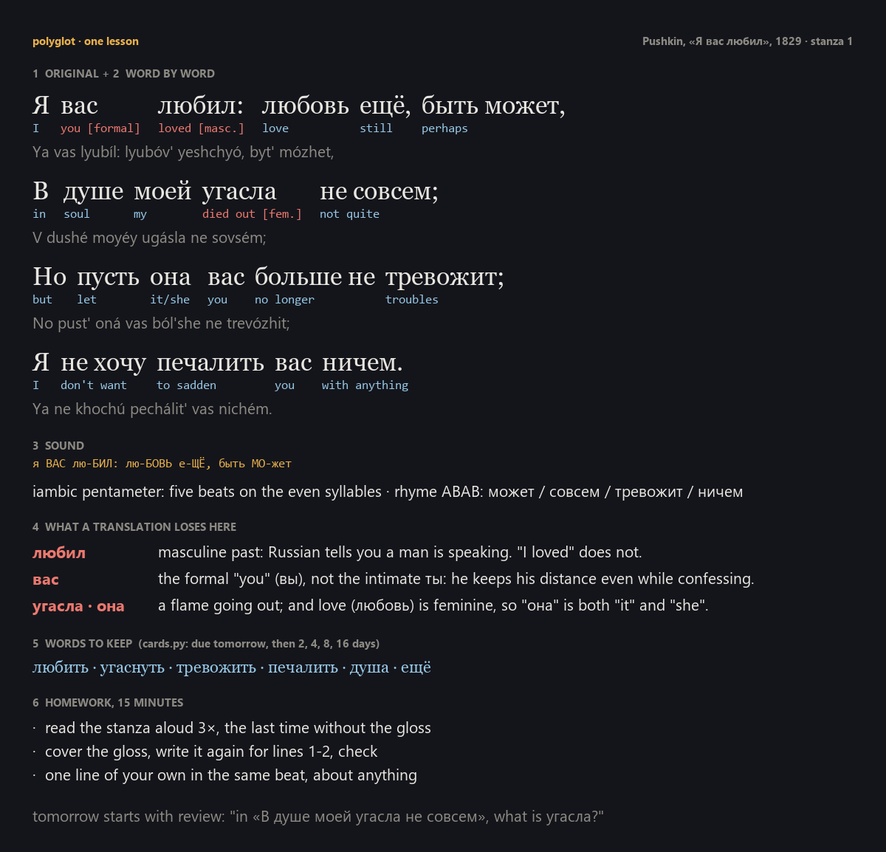

# polyglot

**Learn a language through the poem you want to read in the original.**



> RU: учить язык через стихи, которые хочешь прочесть в оригинале: подстрочник слово в слово, звук и размер, что теряет перевод, слова на завтра, домашка и повторение.

A translation pulls a poem apart into meaning. This Claude skill puts it back together, one stanza at a time: every word
glossed in its form, how the line sounds, the two or three exact things a translation cannot carry, a few words to keep,
and 15 minutes of homework. The next lesson starts with review of yesterday's words, spaced out over days.

## Try it in one minute

Copy the folder into your skills and ask for a poem:

```sh
git clone https://github.com/klavdiy-core/klavdiy-tools && cp -r klavdiy-tools/polyglot ~/.claude/skills/
```

Then in Claude Code: *"I want to read Lorca in Spanish. Start with the first stanza of «Romance sonámbulo». I know
about 100 words."*

## What's inside

- `SKILL.md` — the lesson format and the rules (mark uncertain glosses, poetic vs everyday usage, no whole
  in-copyright poems from memory).
- `cards.py` — the homework words in Leitner boxes: new words are due tomorrow, then after 2, 4, 8, 16 days; a miss
  goes back to box 1. One JSON file in your project, standard library only.

```sh
python cards.py add example/lesson.json     # 6 new card(s)
python cards.py due                         # what to review today
python cards.py grade ru:угаснуть ok
```

## Test

```sh
python -m unittest discover -s tests
```

## License

MIT
