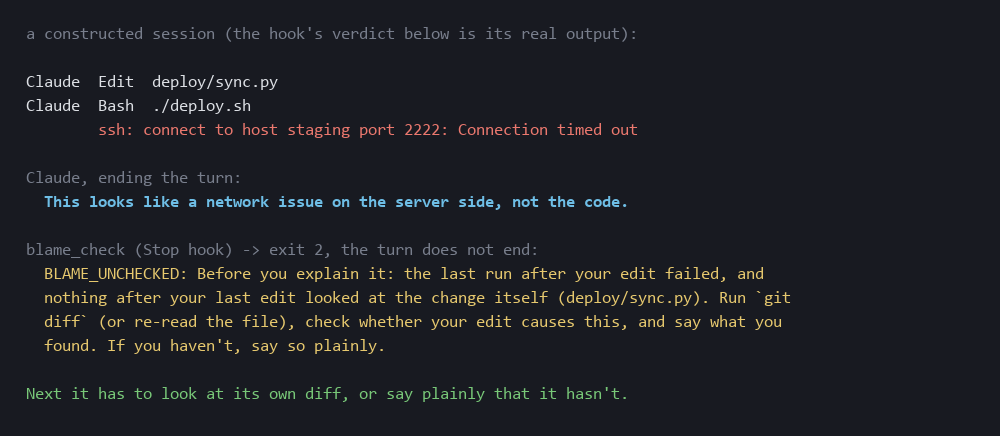

# starter-kit

**Problem.** People wait for the next model to stop their agent from saying "fixed, tests pass" when it never ran the
tests, from loosening a test until it goes green, from saying "there's no such file" when there is. A bigger model
makes these mistakes less often. It still makes them. A rule in `CLAUDE.md` saying "always run the tests" doesn't fire;
I wrote rules like that for months and broke them anyway.

**Fix.** Checks at the moment of action, wired as Claude Code hooks, plus a short `CLAUDE.md` where every rule names
the hook that enforces it. Install into any project in one command.

```
python install.py /path/to/your/project
```

| hook | when | what it does |
|---|---|---|
| [`claim_check.py`](hooks/claim_check.py) | `Stop` | The reply claims success ("fixed", "works", "tests pass", «починил», «тесты проходят»…), the session edited a code file, and **no test command ran after that edit, or the last one failed**. Reply held back (exit 2), the model is told what's missing. Failure is read from the exit code **and** from the output, because `pytest \| tail` exits 0 whatever pytest said. Saying plainly "I haven't run the tests" passes: honesty is the way out, not a skip flag. |
| [`test_guard.py`](hooks/test_guard.py) | `PreToolUse` on `Edit\|MultiEdit\|Write` | An edit to a test file that drops assertions, adds a skip (`skip`, `xfail`, `xit`, `.only`, `@Disabled`, `t.Skip`…) or deletes a test function **asks the human first**, with the counts before and after. |
| [`blame_check.py`](hooks/blame_check.py) | `Stop` | **Check yourself before you blame the network.** The session edited code, and after the last edit nothing looked at the change itself (no `git diff` / `git show`, no re-read of an edited file), and either the last run after the edit **failed** (exit code or output) or the reply blames something outside the code. Reply held back: look at your own diff first. "I haven't ruled out my own change" passes. |
| [`done_check.py`](hooks/done_check.py) | `Stop` | **Definition of done, checked.** If `TASK.md` has a `## Definition of done` section with commands in backticks (`` `pytest -q` passes ``, `` `ruff check .` ``), a reply that says done / fixed / works must stand on each of those commands run **after the last edit**, and none of them failed. Otherwise held back, with the list of what is missing. No `TASK.md`, no check. |
| [`absence_gate`](../absence-gate/) | `Stop` | "There's no X / not found" when the disk has X: held back (wired only if `rg` is installed). |
| [`zero_search_hook`](../absence-gate/zero_search_hook.py) | `PostToolUse` on `Grep` | A search that came back empty only because `.gitignore` or a dot-folder hid the file: the model is told next to the result. |

`install.py` copies the hooks into `.claude/hooks/starter-kit/`, **merges** them into `.claude/settings.json` (your
own hooks and settings stay; a `.bak` is left), and writes [`CLAUDE.md`](CLAUDE.md) only if the project has none.
Running it twice changes nothing.

**Why `blame_check` keys on the transcript, not on the words.**



The first version recognised blame by its wording. On my own example phrases it caught 10 of 10. On a corpus written
blind by another model it caught 4 of 25; tuned on that corpus, 25 of 25; on a second blind corpus: **7 of 29, with
7 false alarms in 50 normal replies** (6 of 29 after narrowing "ни при чём" to "my code … ни при чём": run on my own session, the broad form held a reply that blamed my *other* code) ("CI failed because *I* pinned Node 18…" reads like blame to a regex). Wording is
a weak signal. So the main trigger is a fact in the transcript: the last run after your edit failed and you never looked
at your change. Then any explanation, worded however, waits for a `git diff`. The wording check stays as a fallback
for blaming without having run anything, and the cost of its false alarm is one `git diff`. These two hooks are
checked on transcripts (tests below), not yet in a live Claude Code session; they use the same exit-2 mechanism as
`claim_check`.

**Run on my own session (21 turns), the hooks held two replies.** One was right: I wrote "it works" after editing
`convert.html` without re-running the tests. One was wrong, and it is fixed: edits to throwaway scripts *outside* the
project counted as code edits; now only files inside the project (`cwd` of the hook, or `CLAUDE_PROJECT_DIR`) count.
One limit stays: the wording fallback cannot tell a quoted phrase from a claim.

**About the CLAUDE.md.** It is not mine. My own instruction files stay out of this repository, as the top README says.
This one is a skeleton: a few lines for your project's facts, and three groups of rules (memory in files, verify
before you claim, say "I don't know"), each with the hook that checks it. It is short on purpose. The hooks do the work;
the text only tells the model why it was stopped.

**Every failure is loud.** No transcript, unreadable input, a crash: `claim_check` exits 2 `GATE_BROKEN`, `test_guard`
asks. A broken check must not read as a pass. To avoid a loop, `claim_check` lets go once when Claude Code is already
continuing from a Stop hook (`stop_hook_active`).

**Check that the hooks actually fire: [`hook_doctor.py`](hook_doctor.py).** A hook that never runs looks exactly like a
hook that works. The doctor reads every settings scope (user, project, local, managed, plugin `hooks.json`), runs each
`PreToolUse` hook the way Claude Code runs it (through bash, Git Bash on Windows, never the WSL stub; with
`CLAUDE_PROJECT_DIR` set), feeds it a *canary* (a known-bad call from `hook-doctor.canaries.json`) and reports per hook:
`PASS`, `FAIL` (it let the canary through), `UNTESTED` (no canary: never counted as a pass), `ERROR` (crash, timeout, a
hook that did not start), `FAIL_OPEN` (no Git Bash on Windows: command hooks cannot run at all) or `CANARY MISMATCH`
(the group's matcher would never show the hook that canary). A canary says what it expects, `"deny"` or `"ask"`; a deny
passes an `"ask"` canary too. Matchers follow Claude Code's rules: plain names are exact, anything else is an unanchored
regex. `install.py` writes the canary for its own `test_guard`, so right after installing:

```
$ cd your-project && python .claude/hooks/starter-kit/hook_doctor.py
PASS                                 [project] test_guard.py
hooks: 1  bad: 0
```

Break the hook and it says `FAIL (allowed what it should ask)`, exit 1. Stop hooks (`claim_check`, absence-gate) are out
of its reach: it checks `PreToolUse` only.

**Before an unattended run: `--unattended`.** A run nobody watches stalls on the first prompt nobody answers. This mode
lists what would stop it, exit 1 if anything does:

```
$ python hook_doctor.py --unattended
STOPS  [project] deny rule Bash(git push:*): a run that needs it stops there
STOPS  [local] ask rule Write(**/*.env): asks, and an unattended run has nobody to answer
STOPS  [user] hook test_guard.py asks on an ordinary Bash call
STOPS  permissions: defaultMode 'default': every edit and command not in an allow rule asks (acceptEdits, dontAsk or bypassPermissions do not)
not listed: Claude Code's built-in safety checks (they cannot be read from settings or switched off; they show only when they fire)
```

The hooks are not guessed from their names: each one is run with ordinary calls (`git status`, a Read, an Edit, a
Write, a WebFetch) and named if it asks or denies. The last line is the honest limit: Claude Code's own safety checks
are not in any settings file, so no tool can list them in advance. Built by Klavdia (a Haiku colleague); reviewed, extended and tested end to end
by Aleksandr.

**Tested.** `python tests/test_blame_done.py`: blame_check on a failing run with neutral wording, a failure hidden
behind a pipe, a look at the diff or a re-read of the edited file (only after the edit, only that file), honest
"not ruled out", no edit, a green run, blame wordings EN/RU, loop guard, a missing transcript; done_check on a DoD
command never run, run only before the edit, failed, all green, no claim, honest, no `TASK.md`; install wiring both,
twice (17 planted breaks, all caught; 6 first survived and showed holes in the tests: all transcripts in one file,
an "honest" phrase without a blame, an exit code not checked). `python tests/test_starter.py`: claims with no run, a green run, a red run, a red run hidden behind a pipe,
a run *before* the last edit only, docs-only edits, honest "not tested", Russian phrasings, twelve test-runner command
shapes (including a test file run directly and `--selftest`), assertion drop, a skip alone, a deleted assertion-free
test, MultiEdit, Write over an existing file, broken input, and an install into a project that already has settings, run
twice. Every check here was broken on purpose to see the test go red first (8 planted breaks; 3 of them first survived
and showed holes in the tests, fixed). `claim_check` also reads a real Claude Code transcript: on the session that wrote
it, it found the last test run red behind a `| grep`, which was true at that moment.

**Limits.** It is lexical. `claim_check` knows test commands by shape; a custom runner (`./ci.sh`) is invisible until
you add its pattern. It knows success claims by phrasing; "Shipped! 🚀" slips by. `test_guard` counts, it doesn't
understand: replacing `assert x == 1` with `assert x` keeps the count and passes. A code change made through the
shell also counts as the last code edit, by the shape of the command (`sed -i`, `perl -pi`, `>` into a code file,
`patch`, tree-rewriting git commands, formatters with their write flag, copying, moving or deleting a code file, and
running a script - not `--version`, modules or servers), not by
file fingerprints; so after `python app.py` it asks for a test run before "works". An edit and a test in one command (`sed -i ... &&
pytest`) count as tested. Before, only Edit/Write counted,
and a script that rewrote files let "tests pass" through untested — found by an external review, fixed in 442d78f.
`test_guard` still sees test edits made through Edit/Write only, not through the shell. Not yet exercised in a live Claude
Code loop, only on its transcripts and hook inputs. Tell me what broke.
